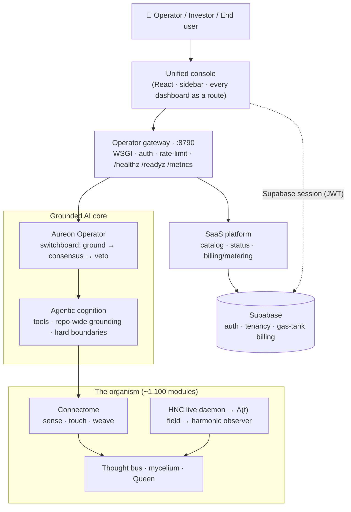

<div align="center">


# Aureon OS

### — Harmonic Nexus Core —

**The operating system for evidence-heavy, high-control work: a grounded AI operating layer.**
Trading research · autonomous operator · planetary/HNC research · a coding organism — one auditable system.


[](LICENSE)


*A product of [R&A Consulting and Brokerage Services Ltd](COMPANY.md) — trading as **Aureon Zorza Technologies** · Belfast, Northern Ireland · Silver-level Innovate NI innovator.*

</div>

---

## What Aureon OS is

Aureon OS is a **local-first operating layer** — powered by the Harmonic Nexus Core — that
lets a human operator run, inspect, and
ground evidence-heavy automation across several domains from one place. It is built to be
*auditable first*: code, ledgers, audits, generated interfaces, and research artifacts are
kept together so a reviewer can always see what exists, what is experimental, and what is
ready for controlled use.

It is organized in three independently reviewable layers:

1. **The implementation platform** — source and offline tests; runtime release is on HOLD.
2. **The research framework (HNC)** — pre-registered, falsifiable hypotheses with evidence.
3. **The vision** — the thread that ties the ancient, the mathematical, and the market together.

> This is the formal front door. The original long-form README is preserved unchanged at
> [`docs/archive/README_legacy_20260712.md`](docs/archive/README_legacy_20260712.md) — nothing was removed, only formalized.

The shared rules for everyone working in this repo are [`docs/AUREON_RULES.md`](docs/AUREON_RULES.md).

### How it fits together



<sub>Every consequential action passes a hard authority boundary + conscience veto before it runs; the platform never trades, pays, or files autonomously.</sub>

---

## 1 · Implementation platform (source-visible; supported runtime is HOLD)

| Capability | What it is | Entry point |
|---|---|---|
| **Aureon Operator** | A grounded AI switchboard — routes a prompt through many models, grounds it in the repo, reaches consensus, and applies a conscience veto before answering. | [`aureon/operator/`](aureon/operator/) · [switchboard doc](docs/architecture/AUREON_OPERATOR_SWITCHBOARD.md) |
| **Agentic cognition** | The operator as an agent: repo-wide grounding, tool use (search / read / code / state), hard authority boundaries enforced before any action. | [`aureon/operator/cognition.py`](aureon/operator/cognition.py) |
| **The organism connectome** | The metacognitive layer that senses, touches, and weaves every module of the body — legacy code included — into one living system. | [`aureon/core/aureon_connectome.py`](aureon/core/aureon_connectome.py) · [doc](docs/architecture/ORGANISM_CONNECTOME.md) |
| **SaaS platform** | A categorized catalog of ~1,100 modules, honest health status, a tenancy bridge, and a billing/metering layer, served behind one gateway. | [`aureon/saas/`](aureon/saas/) · [SAAS_PLATFORM.md](docs/SAAS_PLATFORM.md) |
| **Unified console** | One professional React interface — sidebar, command palette, every dashboard as a route — over the whole repo. | [`frontend/`](frontend/) |
| **Release-boundary implementation** | WSGI, auth, metrics, containers, and CI remain source-visible; supported launchers currently stop at terminal HOLD. | [PRODUCTION_GRADE.md](docs/runbooks/PRODUCTION_GRADE.md) |
| **Multi-user platform** | End-user sign-in with **per-user encrypted keys**, each user reasoning on their own models, and a default-deny boundary between a signed-in user's account and the instance's control plane. | [`aureon/operator/identity.py`](aureon/operator/identity.py) · [MULTI_TENANT_AUTH.md](docs/architecture/MULTI_TENANT_AUTH.md) |

<div align="center">


</div>

### Quickstart

```bash
# 1 · evaluate the isolated operator protection preflight
pip install -e '.[operator]'
python -I -S -B scripts/bootstrap/protected_bootstrap_v05.py --target-id operator

# 2 · build and evaluate the container protection preflights
docker compose -f deploy/docker-compose.saas.yml up --build

# 3 · run the strict-tier test suite (offline, no keys/network)
AUREON_LLM_OFFLINE=1 pytest tests/test_operator_*.py tests/test_saas_*.py tests/test_connectome.py -q
```

### Current local verification boundary

Everything needed to inspect source and run offline tests is in this repo. Do not
inject exchange, model, hosting, or deployment credentials while validating the
current release: the isolated operator bootstrap, containers, and supervisor
entrypoints stay on **HOLD**.

The local installer is the path that brings a clone up. Linux and macOS:
`bash production/install.sh`. Windows: `production\Install-AUREON.ps1` (or
`production\install-windows.bat`). `bash scripts/linux/aureon-up.sh` calls that
installer when the virtualenv is missing, then starts the same preflight.
The shell is `http://127.0.0.1:5173/`. Dashboard and Command Center are tabs of
the local console at `http://127.0.0.1:5173/console/local`. Every other
dashboard and status page — the 8080 console, Orca on 8888, market status on
8791, the gateway on 8790, the fusion seat on 8765, the circulation bus on
8799, the neural canvas, the thought-action hub, the error sink, and API B —
is a tab at `http://127.0.0.1:5173/console/seats`, with the other status
pages (queen unified, pro dashboard, master hub, Earth shield, queen web,
system hub, bot hunter, the dashboard API, queen power, trader telemetry,
Kraken telemetry, and the legacy command center) on that same tab row. Those
tabs read the live buses through the gateway. A source that is down, or a
page that draws invented readings, shows the reason and no invented number.
`AUREON_SIMULATED_BOOT` stays unset, so those generators do not load. The launcher leaves port 8080 alone. Live mode turns on when a complete exchange key group is in
`.env`. With no complete group the boot stays paper/public-data and the health
report says `trading_mode=paper/public-data (no exchange keys)`. With keys it
says `trading_mode=live (exchange keys present)`. The launcher does not place
an order by itself. The thought bus health check is
`http://127.0.0.1:8799/healthz`. The fusion seat keeps
`http://127.0.0.1:8765/healthz`.
A HOLD receipt proves only that the fail-closed preflight ran; it is not proof
that the whole system is protected or production-ready.

### Canonical organism launcher

The terminal-HOLD bootstraps stay holds. The organism launcher is a separate entry. Its default is full autonomy, and it does not place an order by itself:

```bash
scripts/launch/aureon-master.sh
```

Windows uses `scripts/launch/aureon-master.ps1` and `scripts/launch/aureon-master.bat`. On a fresh clone it writes `.env` from `.env.example` when `.env` is absent, installs Python requirements into `.venv`, Node packages for `frontend/`, and the self-host Docker images, then starts the organism and prints a health table. Paths follow the checkout. Trading is live when the operator's own exchange keys are in `.env`. With no keys the report says `trading_mode=paper/public-data (no exchange keys)`. A missing binary, script, or daemon is a blocked row. The mode is in [`AUTONOMY.md`](AUTONOMY.md). The module name and the table are in [`LAUNCHER_INVENTORY.md`](LAUNCHER_INVENTORY.md). What still names a machine is in [`PORTABILITY.md`](PORTABILITY.md).

### How anyone can run it

A fresh clone on your own machine is enough. The launcher does not need Gary's home directory, a hosted runner, or a key that shipped with the repo.

Linux and macOS, from the checkout:

```bash
scripts/launch/aureon-master.sh
```

Windows, from the checkout:

```bat
scripts\launch\aureon-master.ps1
```

`scripts\launch\aureon-master.bat` is the same entry. That one command writes `.env` from `.env.example` when `.env` is absent, installs Python requirements into `.venv`, Node packages for `frontend/`, and the self-host images when Docker answers, then starts the organism. An existing `.env` is left as it is. Paths follow the checkout.

Put your own exchange keys in `.env` after that file exists (Kraken, Binance, Alpaca, or Capital.com: the whole group for that venue). The next boot is live and the health report says `trading_mode=live (exchange keys present)`. With no complete group the same boot stays in paper/public-data mode and the report says `trading_mode=paper/public-data (no exchange keys)`. Do not commit `.env`. The launcher does not place an order by itself.

The boot is unrestricted by default. `AUREON_AUTONOMY_MODE` unset is `full`. Self-coding may edit any path except credential material, approves its own edits, and commits a patch after that patch's tests pass. Nothing is pushed. There is no kill switch and no kill file: `AUREON_SELF_REPAIR_KILL` and `state/SELF_REPAIR_KILL` do not stop a write or an order. Changes and order attempts are appended to `state/autonomy_audit.jsonl`. The unity exchange brain, the unified market trader, the Capital.com CFD trader, and the micro-profit labyrinth each record an attempt. Secret values are redacted. The same records are published on the circulation thought bus. The metacognition and self-repair loops consume them. After repeated failed self-changes, metacognition raises a concern and lowers its confidence, and self-repair deprioritises a target that keeps failing. A self-patch whose tests fail stays applied. It is not reversed. Credentials are still never written into the repo or into a log.

The health table is the last thing the launcher prints. Each row is `order`, `name`, `status`, `health`, and `reason`. A missing binary, script, or daemon is `blocked` with the reason. The totals are `started`, `blocked`, and `total`.

```bash
scripts/launch/aureon-master.sh --status
scripts/launch/aureon-master.sh --stop
```

`--status` prints that table and starts nothing. `--stop` stops the processes this launcher recorded. Postgres, Redis, or nginx it did not start are left alone. On Windows, pass the same flags to `aureon-master.ps1` or `aureon-master.bat`. Those two flags are ordinary process control.

The existing installer is the one step that also brings up the toolchain and the UI. Linux and macOS:

```bash
bash production/install.sh
```

Windows: `production\Install-AUREON.ps1`, or `production\install-windows.bat`. Running it again is safe. It installs Python, venv, Node, npm, git, and curl when apt, dnf, Homebrew, or winget can, writes `.env` from `.env.example` only when `.env` is absent, installs and builds the frontend, then calls the master launcher above. Docker images are used when the daemon answers. With no daemon the launcher uses its native fallbacks. When the UI answers, the installer prints `Aureon UI: http://127.0.0.1:5173/`.

`PyAudio` in `requirements.txt` needs the system audio headers (`portaudio`) before pip can build it. The Linux installer uses `requirements-linux.txt`, which leaves that package out and includes pytest, so `tests/test_preflight_snags.py` can run in the installer environment. Build the test virtualenv with `python -m venv --copies .venv`. A symlinked interpreter fails 32 evidence tests: `sys.executable` must be a real file inside the venv, which `--copies` provides and a symlink into another prefix does not. The installer creates `.venv` with `--copies`. Pytest prints a header note when the interpreter it is running is itself a symlink.

### Archive of unreferenced root files

`archive/workspace-root/` holds notes, one-off scripts, and captured ledgers that the running fleet does not import. Live organ paths stay where [`aureon_fusion/paths.py`](aureon_fusion/paths.py) and [`aureon_fusion/organ_registry.py`](aureon_fusion/organ_registry.py) name them. Fleet output stays untracked.

Direct-module and go-live runbooks are superseded until native process
containment, target-source measurement, external HNC head anchoring, and
provider-side read-back are proven.

### Multi-user implementation status

The source contains a proposed single-operator and multi-user separation model,
but no supported runtime starts it while the release is on HOLD:

| | The operator | A signed-in end user |
|---|---|---|
| **Keys** | the instance's own, in `os.environ` + the global keystore | **their own**, Fernet-encrypted in an isolated per-account store, masked to last-4 on read, never written into the process environment |
| **Reasoning** | the instance engine, full toolbelt | **their own models**, on a request-scoped engine with a pure-compute toolbelt — no shell, no repo write, no network egress, no instance-state read |
| **Memory** | the shared thought bus and mesh | isolated: their prompts and answers never enter shared instance memory |
| **Control plane** | theirs — switchboard, host actions, approvals, manifests, MCP, instance credentials | **refused**. A tenant reaches an explicit allowlist; every other `/api` route is operator-only by omission |

The intended request boundary is centralized and default-deny rather than
implemented independently per route. This is an implementation claim backed by
tests, not evidence of a deployed tenant service.

The design history and adversarial findings remain in
[`docs/architecture/MULTI_TENANT_AUTH.md`](docs/architecture/MULTI_TENANT_AUTH.md).
Do not add tenant, operator, model, or hosting secrets merely to inspect this
source. Network exposure remains outside the current release boundary.

---

## 2 · The research framework — HNC (pre-registered & falsifiable)

Aureon is built on the **Harmonic Nexus Core (HNC)** — a research framework proposing that a
φ² (golden-ratio-squared) mathematical coherence links ancient knowledge systems, geopolitical
stress in open data, and market dynamics. These are **research hypotheses**, stated as
falsifiable claims with reproduction commands — never as financial promises.

| Claim | Value | Evidence & how to reproduce |
|---|---|---|
| Oil volatility → open-data node activation | r = 0.85, p < 0.001, 24–48h lag | [`CLAIMS_AND_EVIDENCE.md §C1`](docs/CLAIMS_AND_EVIDENCE.md) |
| φ² hydrogen-line reproduction | 1,420.405754 MHz vs NIST 1,420.405752 MHz (ppb) | [`CLAIMS_AND_EVIDENCE.md §C6`](docs/CLAIMS_AND_EVIDENCE.md) |
| Pre-registered predictions (P1–P5) | falsifiable, tracked | [`CLAIMS_AND_EVIDENCE.md`](docs/CLAIMS_AND_EVIDENCE.md) · [falsification protocol](docs/HNC_FALSIFICATION_PROTOCOL.md) |

Every claim links to the file that establishes it and a command you can run. If a claim is not
backed by a source, it is a bug — the repository is the authority. See the full spine in
[`docs/CLAIMS_AND_EVIDENCE.md`](docs/CLAIMS_AND_EVIDENCE.md).

<div align="center">

<br/><sub>A worked example: the Feb 5–6 geomagnetic-convergence event, predictions checked against verified public data (NASA/NOAA, Reuters). Research/education only — not financial advice.</sub>
</div>

---

## 3 · The vision

> *The same coherence that organized the Ziggurats of Ur, the Great Pyramid, and the Roman road
> network expresses itself now — measurably — in the rhythms of open data and markets. Aureon is
> the instrument built to listen for it, and to act only with a conscience in the loop.*

The full thread — the ancient substrate, the mathematics, the extraction machine, and the
distributed response — is told in the creator's own voice in
[`docs/THE_SYNTHESIS.md`](docs/THE_SYNTHESIS.md).

---

## Company & credentials

**[R&A Consulting and Brokerage Services Ltd](COMPANY.md)** — registered in Northern Ireland,
**company no. NI696693** — trading as **Aureon Zorza Technologies**.

- 🏅 **Silver-level innovator** on the Innovate NI Innovation Framework (Department for the Economy / Tourism NI), awarded 21 July 2025 by the Minister for the Economy. → [certificate](docs/images/innovate_ni_silver_2025.png)
- 🤝 **Community**: a supporter of Street Soccer NI / Homeless World Cup (Norway 2025). → [`COMPANY.md`](COMPANY.md)
- 🌐 Website: [aureonzorzatechnologies.pl](https://aureonzorzatechnologies.pl)
- 📄 License: [MIT](LICENSE) · © 2025 R&A Consulting and Brokerage Services Ltd
- Full company details: [`COMPANY.md`](COMPANY.md)

### Early interest

Open-source repository traffic to date (verifiable in the repo's GitHub **Insights → Traffic**):

<div align="center">


</div>

<sub>These are **repository clone-traffic** figures (developer/researcher interest in the code), not user, customer, or revenue numbers. Source: GitHub Insights.</sub>

---

## Where to go next

| You are… | Start here |
|---|---|
| **Working on Aureon OS** | [`docs/AUREON_RULES.md`](docs/AUREON_RULES.md) — the shared rulebook |
| **An investor or funder** | [`docs/investor/README.md`](docs/investor/README.md) — diligence path, capability categories, and claim discipline |
| **A developer** | [`docs/INDEX.md`](docs/INDEX.md) · [`CAPABILITIES.md`](CAPABILITIES.md) · [`docs/SAAS_PLATFORM.md`](docs/SAAS_PLATFORM.md) |
| **A researcher** | [`docs/THE_SYNTHESIS.md`](docs/THE_SYNTHESIS.md) · [`docs/CLAIMS_AND_EVIDENCE.md`](docs/CLAIMS_AND_EVIDENCE.md) · [`docs/research/READING_PATHS.md`](docs/research/READING_PATHS.md) |
| **Deployment status** | [`docs/runbooks/GO_LIVE_HARDENING.md`](docs/runbooks/GO_LIVE_HARDENING.md) · [`docs/deployment/`](docs/deployment/) — terminal HOLD; no supported listener or deploy route |
| **Running it for several users** | [`docs/architecture/MULTI_TENANT_AUTH.md`](docs/architecture/MULTI_TENANT_AUTH.md) — the account/instance boundary and how it is enforced |
| **Checking what the numbers mean** | [`docs/architecture/DATA_PROVENANCE_AUDIT.md`](docs/architecture/DATA_PROVENANCE_AUDIT.md) — which readings are live, which are withheld as `no_data`, and which generated feeds are opt-in |
| **Browsing the whole repo** | [`docs/REPO_SITEMAP.md`](docs/REPO_SITEMAP.md) · the console's `#repo-map` tab |
| **Contributing** | [`CONTRIBUTING.md`](CONTRIBUTING.md) · [`SECURITY.md`](SECURITY.md) · [`CODE_OF_CONDUCT.md`](CODE_OF_CONDUCT.md) |

---

## Continuous integration

Quality evidence is suite- and revision-specific. Run the current offline tests
and static checks rather than relying on historical pass counts or badges. A
passing implementation suite does not override the terminal release HOLD.

The hosted GitHub Actions status badges below turn green once Actions is enabled on the
organization (they reflect hosted runs, not the local gate):

[](https://github.com/RA-CONSULTING/Aureon-OS/actions/workflows/operator-ci.yml)
[](https://github.com/RA-CONSULTING/Aureon-OS/actions/workflows/main_ci.yml)
[](https://github.com/RA-CONSULTING/Aureon-OS/actions/workflows/nightly-benchmark.yml)

```bash
# reproduce the gate locally
pip install -e '.[operator,dev]'
ruff check aureon/operator/ aureon/saas/ && mypy aureon/operator/ aureon/saas/
AUREON_LLM_OFFLINE=1 pytest tests/test_operator_*.py tests/test_saas_*.py tests/test_connectome.py -q

# evaluate the capability-demo protection preflight; it currently returns HOLD
# without importing or booting the capability surface
AUREON_LLM_OFFLINE=1 AUREON_SUPPRESS_IMPORT_SIDE_EFFECTS=1 \
  python -I -S -B scripts/bootstrap/protected_bootstrap_v05.py --target-id capability-demo -- --report docs/reports/CAPABILITY_DEMO.md
```

## Operating boundaries

Aureon is designed for **controlled local operation with a human in the loop**. Live trading,
warehouse mutation, filing support, payment activity, and other sensitive workflows require
explicit operator review, valid credentials, and route-specific evidence — the platform never
initiates them autonomously. Public documentation describes capability and repository state; it
is **not financial, legal, tax, or regulatory advice**, and nothing here is an offer of
securities or a promise of returns. Private credentials, customer data, and sensitive local
evidence are not published in this repository.

---

<div align="center">
<sub>Aureon OS · Harmonic Nexus Core — a product of R&A Consulting and Brokerage Services Ltd, trading as Aureon Zorza Technologies.</sub>
</div>
