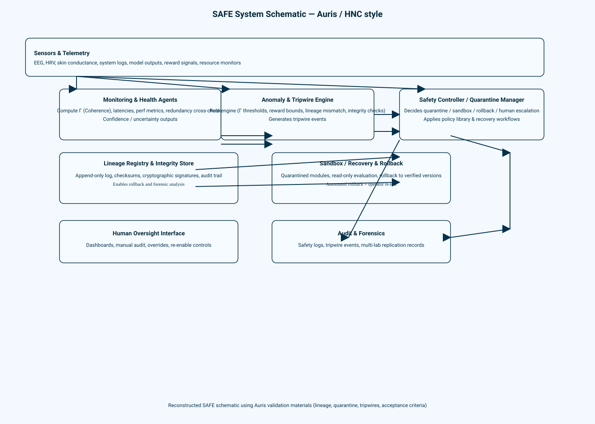

# SAFE System Schematic (Auris / HNC Style)

This diagram consolidates the SAFE monitoring and containment workflow that the Auris validation materials describe. The core modules work together as follows:

- **Sensors & Telemetry** capture physiological signals (EEG, HRV, skin conductance) alongside system-level observability feeds (logs, model outputs, reward signals, resource monitors).
- **Monitoring & Health Agents** synthesize the raw telemetry into coherence metrics Γ, latency dashboards, redundancy checks, and confidence estimates.
- **Anomaly & Tripwire Engine** continuously evaluates rule thresholds (Γ, reward bounds, lineage mismatches, integrity checks) and emits tripwire events when safeguards are violated.
- **Safety Controller / Quarantine Manager** orchestrates quarantine, sandbox, rollback, or human escalation responses while applying the vetted policy and recovery playbooks.
- **Lineage Registry & Integrity Store** maintains append-only provenance with checksums and signatures to underpin audits and provide reliable rollback anchors.
- **Sandbox / Recovery & Rollback** executes quarantined evaluation, performs automated rollbacks to verified versions, and routes artifacts for operator re-testing.
- **Human Oversight Interface** exposes dashboards, manual audit capabilities, and override toggles that allow operators to re-enable controls deliberately.
- **Audit & Forensics** archives safety logs, tripwire events, and multi-lab replication data so incidents can be reconstructed with full fidelity.

Bidirectional links between the Safety Controller, Lineage Registry, sandbox, and human oversight ensure the system can cycle between automated containment and informed human judgment without losing traceability.
